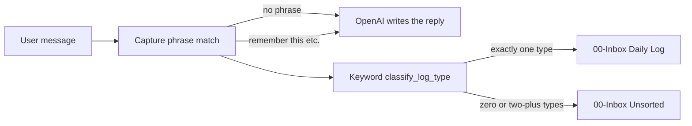

# Second Brain — problem statement

Working document. **Product direction (2026-10-11):** v2 LLM Wiki — Claude files and links from `Inbox/` into Notes/People/Projects/Concepts. Canonical spec: [architecture.md](architecture.md). The v1 “never auto-file” text below is historical. Not a multi-agent Friends product.

---

## 1. Working title

**How can a single conversational agent capture everyday experience into a trusted personal knowledge vault without over-structuring at the moment of capture, and without pretending keyword rules are understanding?**

---

## 2. Context and motivation

People already dump thoughts into chatbots and into note apps, but those systems pull in opposite directions.

- **Chatbots** (ChatGPT-class models) infer meaning from messy language. They do not leave you a durable, inspectable folder of notes you own if the product disappears.
- **Second-brain / PKM tools** (Obsidian, PARA, MOCs) make knowledge durable and queryable, but logging is slow. Anything that adds a folder picker, tags, or a form at capture time kills the habit before the system is proven.
- **v1 constraint:** capture fast, structure later. One write target. Markdown is the source of truth. Atomic notes and 01–05 folders are created in review by a human, not by the bot mid-conversation.

The project is a **personal, single-user conversational capture-and-chat system** whose long-term memory is an Obsidian vault on disk, not a proprietary database.

Chat replies fluently via OpenAI, but **log type** (food, finance, idea, task, exercise) is a keyword list. The model sounds smart; filing is still brittle.

---

## 3. Problem statement

Knowledge workers need a way to **speak or type messy everyday events** (meals, expenses, ideas, to-dos, workouts, meetings) into a system that **answers in natural language** and **writes an attributable, reversible record** into a vault they own—without forcing them to classify, file, or format at capture time. Existing chat products do not produce a trustworthy, reviewable daily log. Existing PKM tools do not infer intent from conversation. Hybrid “AI second brains” often auto-file into many folders, which produces a tidy vault nobody trusts. **The problem is to design a capture contract and a conversational loop that stay boring enough to use every day, while still using a large language model for dialogue—and to decide, explicitly, where the model is allowed to classify versus where rules and human review must remain in control.**

---

## 4. Who this is for

- **Primary user:** you (single-user, local Mac, Obsidian vault at `Documents/SecondBrain`). Phone access is the same app over Tailscale (Mac must be on).
- **Failure modes:** thoughts stay in SQLite chat and never become notes; they land in Unsorted because language missed a keyword; or the bot writes 01–05 and you stop trusting the vault.
- **Not in scope:** multi-tenant SaaS, App Store as the daily path, Dialogflow/Lex, six specialist characters as the product.

---

## 5. Current system

- **Dialogue:** OpenAI. Not Google Dialogflow.
- **Whether to write:** capture phrases in `backend/src/agents/_base.py` (`remember this`, `write this down`, …).
- **What type to write:** `_TYPE_KEYWORDS` / `classify_log_type` in `backend/src/integrations/obsidian.py`. Five types. One hit → `## Log`; else Unsorted.
- **Trust contract:** append-only; timestamp + `src::`; never edit history; never create files in 01–05.

**Tension:** the reply is generative; the log type is not. “Lunch meeting” is food + task → Unsorted. “I have a meeting tomorrow” with no capture phrase → no write.

---

## 6. Core questions

1. **Capture vs conversation.** Ritual phrase vs propose-and-confirm (H1 in the research plan).
2. **Classification authority.** Keywords vs LLM with Unsorted fallback vs untyped Log (H2, H3).
3. **Evaluation.** P1 evening tally; later kappa on ~100 labeled messages.
4. **Trust.** Today’s daily note in the prompt without rewriting the Log.
5. **Modality.** Voice/images as input only, same capture contract.

---

## 7. Design principles

1. One capture target: `00-Inbox/Daily/YYYY-MM-DD.md` under `## Log`.
2. Markdown is source of truth; SQLite is chat cache only.
3. Structure emerges in review, not at capture.
4. Every bot write is attributable and reversible (append, don’t edit).
5. Five entry types until a sixth one actually hurts.
6. Unparseable input is never dropped (Unsorted or `99-System/Logs/`).

---

## 8. Success criteria

- One utterance → same-day line in Daily or Unsorted.
- Wrong types visible; corrections are new lines.
- Chat can use today’s Log without inventing vault structure.
- Weekly review still happens; the bot does not replace it.
- Any LLM classifier is compared offline against keywords first ([research-plan.md](research-plan.md)).
